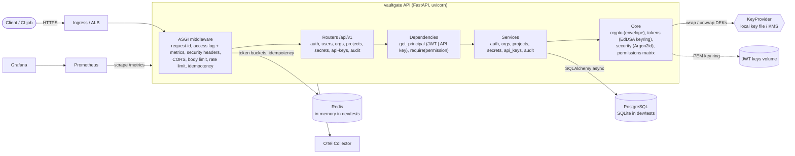
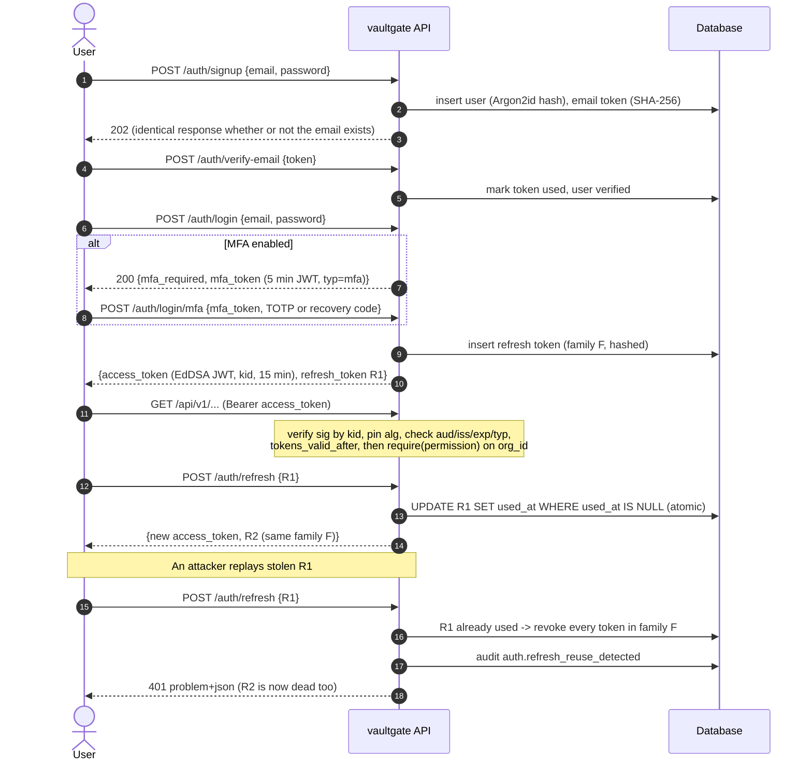
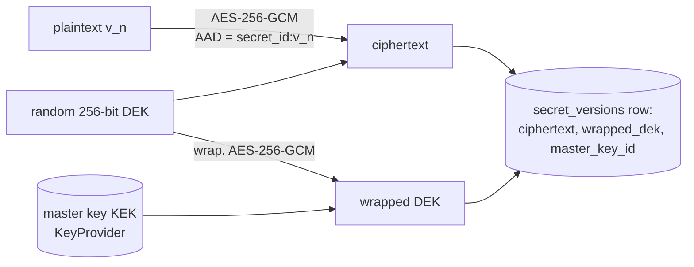

# vaultgate

**Secrets & API-key management for teams** - a multi-tenant REST API built with
FastAPI, async SQLAlchemy 2.0 and a security-first design: envelope encryption,
rotating EdDSA JWTs, refresh-token reuse detection, RBAC, scoped API keys and a
tamper-evident audit log.


> Think "a small, readable HashiCorp Vault / Doppler": organisations have members
> with roles, projects hold versioned secrets that are encrypted at rest, CI systems
> read secrets with narrowly-scoped API keys, and every action lands in a hash-chained
> audit trail you can verify from the command line.

---

## Contents

- [Features](#features)
- [Architecture](#architecture)
- [Authentication flow](#authentication-flow)
- [Quick start (SQLite dev mode)](#quick-start-sqlite-dev-mode)
- [Full stack with Docker Compose](#full-stack-with-docker-compose)
- [API overview](#api-overview)
- [Security](#security) - threat model, OWASP API Top 10 mapping
- [Testing & quality](#testing--quality)
- [Project layout](#project-layout)
- [Operations](#operations)
- [Roadmap](#roadmap)

## Features

| Area | What you get |
|---|---|
| **Identity** | Signup with email verification (pluggable email provider), Argon2id passwords with rehash-on-login, NIST-style password policy, account lockout, enumeration-resistant responses |
| **Sessions** | 15-minute **EdDSA (Ed25519) JWTs** with `kid` key rotation + JWKS endpoint; opaque refresh tokens stored hashed, **rotated on every use with reuse detection** that revokes the whole token family |
| **MFA** | TOTP (RFC 6238) with replay protection and 10 single-use recovery codes; seeds are envelope-encrypted |
| **Authorisation** | Roles `owner / admin / member / viewer` per organisation, one permission matrix, `Depends(require(Permission.X))` on every route, 404-not-403 for foreign tenants |
| **API keys** | `vg_live_...` keys (`vg_test_` outside prod), shown once, stored as SHA-256, scoped, expiring, `last_used_at`; usable via `X-API-Key` or `Bearer` |
| **Secrets** | **Envelope encryption** (AES-256-GCM, per-version DEK wrapped by a master key from a `KeyProvider`), row-bound AAD, versioning, soft delete/restore, master-key rotation + re-wrap CLI |
| **Audit** | Append-only table (DB triggers) with a **SHA-256 hash chain**; `vaultgate verify-audit-chain` detects edits, deletions and truncation |
| **Hardening** | Token-bucket rate limiting (per IP, per API key, strict auth bucket; in-memory or Redis/Lua), body-size limits, strict CORS, security headers, request IDs, `Idempotency-Key`, cursor pagination, RFC 7807 errors |
| **Observability** | structlog JSON logs with secret redaction, Prometheus metrics (route-templated), OpenTelemetry tracing, `/healthz` + `/readyz`, graceful shutdown |
| **Delivery** | Multi-stage non-root Docker image, Compose stack (Postgres, Redis, OTel Collector, Prometheus, Grafana), hardened Kubernetes manifests, Terraform AWS skeleton, GitHub Actions CI with pip-audit + Trivy |

## Architecture



Layering is strict: routers do HTTP only, services own transactions and write
audit events, `core` has no knowledge of HTTP or the database.

## Authentication flow



## Quick start (SQLite dev mode)

Requires Python 3.12. No Docker, Postgres or Redis needed - dev mode uses SQLite,
in-memory rate limiting and auto-generated development keys (in `./.keys/`,
git-ignored).

```bash
git clone https://github.com/Josh2106/vaultgate && cd vaultgate
python -m venv .venv && source .venv/bin/activate     # Windows: .venv\Scripts\activate
pip install -r requirements-dev.lock && pip install --no-deps -e .
cp .env.example .env
alembic upgrade head
uvicorn app.main:app_factory --factory --reload
```

Windows PowerShell: `./scripts/tasks.ps1 install` then `./scripts/tasks.ps1 run`.

Open <http://localhost:8000/docs>. The **console** email backend prints the
verification token to the server log.

### End-to-end transcript

Recorded against a live `uvicorn` on SQLite (tokens truncated):

```text
$ POST /api/v1/auth/signup
{"detail":"If the address can be registered, a verification email has been sent."}
$ POST /api/v1/auth/verify-email   (token read from console email log)
HTTP 204
$ POST /api/v1/auth/login
{'access_token': 'eyJhbGciOiJFZERTQSIsImtp...', 'refresh_token': 'vgr_M9r2TdHQl-pdChEegBWS...', 'token_type': 'bearer', 'expires_in': 900}
$ POST /api/v1/orgs  (Idempotency-Key: org-create-001)
{"id":"61847384-...","name":"Acme Corp","slug":"acme","created_at":"2026-11-26T13:14:15.333785Z"}
$ POST /api/v1/orgs  (same Idempotency-Key replayed)
HTTP/1.1 201 Created
idempotent-replayed: true
$ POST .../projects/{id}/secrets  {"name":"STRIPE_SECRET_KEY", ...}
{"id":"283e45cc-...","name":"STRIPE_SECRET_KEY","current_version":1, ...}
$ PUT .../secrets/STRIPE_SECRET_KEY   (rotate -> v2)
{"id":"283e45cc-...","name":"STRIPE_SECRET_KEY","current_version":2, ...}
$ GET .../secrets/STRIPE_SECRET_KEY?version=1
{..., "version":1, "value":"sk_live_51Hx-demo-value"}
$ POST /api/v1/orgs/{id}/api-keys   {"scopes":["secret:read"]}
{"prefix":"10e7ef793039","scopes":["secret:read"], ..., "key":"vg_test_10e7ef793039_...(shown once)"}
$ GET .../secrets/STRIPE_SECRET_KEY   with X-API-Key
sk_live_51Hx-rotated-value
$ GET .../secrets   with X-API-Key (scope secret:list missing)
{"type":"urn:vaultgate:problem:permission-denied","title":"Permission denied","status":403,
 "detail":"Missing permission 'secret:list'.", ..., "request_id":"5398cda4..."}
$ POST /api/v1/auth/refresh   (replay OLD refresh token)
{"type":"urn:vaultgate:problem:invalid-token","status":401,
 "detail":"Refresh token reuse detected; all sessions in this family revoked.", ...}
$ GET /api/v1/orgs/{id}/audit-events?limit=3
seq=11  secret.read            actor=api_key:f75ecfee hash=d7a505c87ebffb52...
seq=10  api_key.created        actor=user:08edb057    hash=e03660bea8e72d8c...
seq=9   secret.read            actor=user:08edb057    hash=4d0ed6d386dd77f7...
$ vaultgate verify-audit-chain
OK: audit chain intact (13 events verified)
```

## Full stack with Docker Compose

```bash
docker compose up --build
```

Starts `api` (staging mode: Postgres + Redis, docs disabled, HSTS on, read-only
root FS, all capabilities dropped), `postgres`, `redis`, `otel-collector`,
`prometheus` (:9090) and `grafana` (:3000, provisioned dashboard). One-shot
`keys-init` and `migrate` services generate development keys into a volume and
run `alembic upgrade head` before the API starts.

> The Compose file, Dockerfile, Kubernetes manifests and Terraform were written
> and YAML-validated on a machine without Docker/Terraform. CI builds the image,
> smoke-tests it, runs Trivy, `kubeconform` and `terraform validate`.

## API overview

All routes are under `/api/v1`. Errors are always `application/problem+json`.

| Method & path | Permission | Notes |
|---|---|---|
| `POST /auth/signup` | public | 202, enumeration-resistant |
| `POST /auth/verify-email`, `/auth/verify-email/resend` | public / user | single-use token |
| `POST /auth/login`, `/auth/login/mfa`, `/auth/token` | public | `/token` is the OAuth2 password flow for Swagger |
| `POST /auth/refresh`, `/auth/logout`, `/auth/logout-all` | public / user | rotation + reuse detection |
| `POST /auth/password/change` | user | revokes all sessions |
| `POST /auth/2fa/setup`, `/enable`, `/disable` | user | TOTP + recovery codes |
| `GET /users/me` | user | |
| `POST /orgs`, `GET /orgs` | verified user | creator becomes owner |
| `GET / PATCH / DELETE /orgs/{org_id}` | `org:read` / `org:update` / `org:delete` | |
| `GET / POST /orgs/{org_id}/members`, `PATCH / DELETE .../{user_id}` | `member:read` / `member:manage` | owner-only for owner role; last-owner guard |
| `GET / POST /orgs/{org_id}/projects`, `GET / PATCH / DELETE .../{project_id}` | `project:read` / `project:write` / `project:delete` | |
| `GET .../secrets`, `GET .../secrets/{name}/versions` | `secret:list` | metadata only |
| `GET .../secrets/{name}[?version=n]` | `secret:read` | decrypts; **audited** |
| `POST .../secrets`, `PUT .../secrets/{name}` | `secret:write` | each PUT is a new version |
| `DELETE .../secrets/{name}`, `POST .../{name}/restore` | `secret:delete` | soft delete |
| `GET / POST /orgs/{org_id}/api-keys`, `DELETE .../{key_id}` | `apikey:read` / `apikey:manage` | key shown once |
| `GET /orgs/{org_id}/audit-events[?action=]` | `audit:read` | newest first, cursor-paginated |
| `GET /.well-known/jwks.json`, `/healthz`, `/readyz`, `/metrics` | public / token | metrics can require `VG_METRICS_TOKEN` |

### Role matrix

| Permission | viewer | member | admin | owner | API-key grantable |
|---|:-:|:-:|:-:|:-:|:-:|
| `org:read`, `member:read`, `project:read`, `secret:list` | yes | yes | yes | yes | `org:read`, `project:read`, `secret:list` |
| `secret:read`, `secret:write` | | yes | yes | yes | yes |
| `org:update`, `member:manage`, `project:write`, `project:delete`, `secret:delete`, `apikey:read`, `apikey:manage`, `audit:read` | | | yes | yes | `project:write`, `secret:delete`, `audit:read` only |
| `org:delete` | | | | yes | no |

Defined once in [`app/core/permissions.py`](app/core/permissions.py) and tested
exhaustively (20 endpoints x 4 roles).

## Security

Full details: [`docs/security-design.md`](docs/security-design.md) (assets,
crypto design, STRIDE threat model with the test that verifies each mitigation,
residual risks) and the [ADRs](docs/adr).

### Envelope encryption in one picture



### Threat model summary (STRIDE)

| Threat | Category | Mitigation |
|---|---|---|
| Credential stuffing, brute force | Spoofing | Strict per-IP auth bucket, lockout after 5 failures, Argon2id |
| Stolen refresh token | Spoofing | Rotation + reuse detection revokes the family |
| JWT forgery / alg confusion | Spoofing, EoP | Ed25519 only, `kid` whitelist, required claims, `typ` separation |
| Ciphertext swapped between rows | Tampering | Row-bound AAD; decrypt fails closed and is audited |
| Audit trail edited to hide actions | Repudiation, Tampering | Append-only triggers + hash chain + `verify-audit-chain` |
| DB dump / backup leak | Information disclosure | Envelope encryption, hashed tokens/keys, KEK outside DB |
| Cross-tenant reads (BOLA) | Information disclosure | `org_id`-scoped queries; foreign resources are 404 |
| Account enumeration | Information disclosure | Uniform signup/login/lockout responses and timing |
| Large bodies, key spraying, retries | Denial of service | Body limits, bounded token buckets, idempotency keys |
| Role escalation / over-scoped keys | Elevation of privilege | Single permission matrix, owner-only owner changes, non-delegable governance scopes |

### OWASP API Security Top 10 (2023) checklist

| OWASP risk | Control in vaultgate | Where |
|---|---|---|
| API1 Broken Object Level Authorization | Every lookup scoped by authorised `org_id`; IDs from another tenant return 404 | `api/deps.py::require`, `services/projects.py::get_project` |
| API2 Broken Authentication | Argon2id, lockout, MFA, short-lived EdDSA JWTs, refresh rotation + reuse detection, hashed tokens | `services/auth.py`, `core/tokens.py` |
| API3 Broken Object Property Level Authorization | `extra="forbid"` request schemas; explicit response models (no hashes, no key material after creation) | `schemas/` |
| API4 Unrestricted Resource Consumption | Token buckets per IP / key / auth, body limit, page size cap, secret size cap | `middleware/`, `services/pagination.py` |
| API5 Broken Function Level Authorization | `require(Permission)` on every org route; matrix tested for every role | `core/permissions.py`, `tests/integration/test_rbac.py` |
| API6 Unrestricted Access to Sensitive Business Flows | Strict auth bucket, enumeration-resistant signup, idempotent POSTs | `middleware/protection.py` |
| API7 Server Side Request Forgery | No user-controlled outbound requests exist | n/a by design |
| API8 Security Misconfiguration | Production settings validator, security headers, strict CORS, docs disabled in prod, non-root read-only container, restricted PSS | `core/config.py`, `middleware/core.py`, `k8s/` |
| API9 Improper Inventory Management | Versioned `/api/v1`, OpenAPI generated from code, JWKS published | `api/v1/` |
| API10 Unsafe Consumption of APIs | Only the email provider is external and sits behind an interface; inputs from it are not trusted | `core/email.py` |

## Testing & quality

| Check | Result (local run, Windows 11, Python 3.12.10) |
|---|---|
| `pytest -n auto` | **206 passed** in ~66 s |
| Coverage (`--cov=app`, branch) | **97.7 %** (2 689 statements; CI gate is 85 %) |
| `ruff check` / `ruff format --check` | clean |
| `mypy --strict` (app **and** tests) | clean, 66 files (only `pyotp`/`fakeredis` lack stubs) |
| Alembic | upgrade/downgrade round-trip and **zero model drift** asserted in tests; Postgres DDL rendered offline |

What the suite covers:

* **Auth flows** - signup/verify/login, enumeration resistance, password policy,
  lockout + expiry, refresh rotation, **reuse detection revoking the family**,
  logout / logout-all / password change invalidating tokens, full TOTP lifecycle
  incl. replay rejection and recovery codes, JWT `kid` rotation via JWKS.
* **RBAC** - parametrised 20 endpoints x 4 roles matrix, cross-tenant IDOR, API-key
  scopes, org binding, revocation, expiry, malformed keys, member-management rules.
* **Crypto** - round-trip, AAD mismatch, bit flips, foreign/unknown keys,
  **master-key rotation + re-wrap + old-key removal**, ciphertext transplant attack.
* **Audit** - every mutation recorded with actor/IP/UA/request-id, DB triggers
  reject UPDATE/DELETE, **5 tampering variants detected**, CLI exit codes.
* **Platform** - rate limits (IP, key, auth), idempotency replay/mismatch/in-flight
  409, body limits (declared and chunked), CORS, security headers, request IDs,
  problem+json, readiness/draining, metrics, OpenTelemetry spans, Redis backends
  (via `fakeredis` with real Lua execution), lifespan through the middleware stack.
* **Property-based (Hypothesis)** - envelope encryption and cursor round-trips;
  *any* Unicode secret value survives create/update/read through the live API
  (it guards a whitespace-stripping bug found while writing it); arbitrary JSON
  against `/auth/signup` never yields a 5xx and is always problem+json.

Tests run against SQLite and in-memory backends so they need no services; CI
additionally applies the migrations to a real Postgres 16.

## Project layout

```text
app/
  main.py               application factory, lifespan (graceful shutdown), middleware order
  cli.py                vaultgate verify-audit-chain | rotate-master-key | rewrap-secrets | ...
  state.py              process-wide resources (engine, key rings, limiter, stores)
  api/
    deps.py             get_principal (JWT or API key), require(permission)
    system.py           /healthz /readyz /metrics /.well-known/jwks.json
    v1/routers/         auth, users, orgs, projects, secrets, api_keys, audit
  core/                 config, errors (RFC 7807), crypto, tokens, security, permissions,
                        ratelimit, idempotency, logging, metrics, telemetry, email, net
  db/                   base types (UTC datetimes), models, session
  middleware/           request id, access log, security headers, body limit,
                        rate limit, idempotency (pure ASGI)
  schemas/              Pydantic v2 request/response models
  services/             business logic + transactions + audit writes
migrations/             Alembic (async env, append-only triggers)
tests/                  unit/, integration/, test_property.py
docs/                   security-design.md, adr/0001-0005
deploy/                 otel-collector, prometheus, grafana provisioning
k8s/                    kustomize: deployment, HPA, PDB, ingress, network policies, ExternalSecrets
terraform/              AWS ECR + ECS Fargate skeleton
scripts/tasks.ps1       Windows task runner (mirrors the Makefile)
```

## Operations

| Task | Command |
|---|---|
| Verify audit integrity (cron it) | `vaultgate verify-audit-chain` (exit 2 on tamper) |
| Rotate master key | `vaultgate rotate-master-key`, restart, `vaultgate rewrap-secrets` |
| Rotate JWT signing key | `vaultgate generate-jwt-key`, deploy, retire old PEM after 15 min |
| Migrations | `alembic upgrade head` (Kubernetes: `k8s/migrate-job.yaml` PreSync hook) |
| Re-pin dependencies | `make lock` / `./scripts/tasks.ps1 lock` |

Shutdown: in Kubernetes a `preStop` sleep lets the endpoints controller stop
routing to the pod first; on SIGTERM uvicorn stops accepting connections and
drains in-flight requests (bounded by `--timeout-graceful-shutdown`); the
lifespan hook then marks the process as draining (`/readyz` answers 503) and
disposes the DB pool and Redis client.

## Roadmap

- [ ] AWS KMS / Vault Transit `KeyProvider` (KEK never in process memory)
- [ ] Anchor audit chain head externally (S3 Object Lock / signed checkpoints)
- [ ] Password reset flow and breached-password check (HIBP k-anonymity)
- [ ] Org invitations by email instead of adding existing users
- [ ] WebAuthn / passkeys as a second factor
- [ ] Secret references and environment bundles (`dev` / `staging` / `prod`)
- [ ] Per-org audit chains and export to SIEM
- [ ] Terraform: RDS, ElastiCache, ALB wiring, key-file delivery for Fargate

## License

[MIT](LICENSE) (c) 2026 Joshua Kumar ([@Josh2106](https://github.com/Josh2106))
